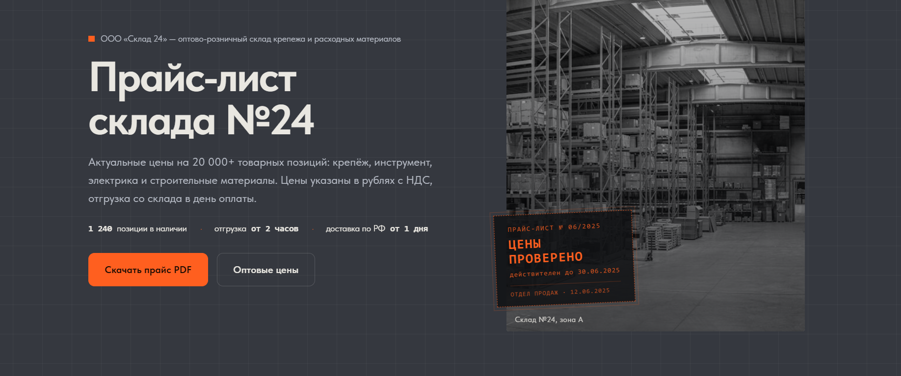
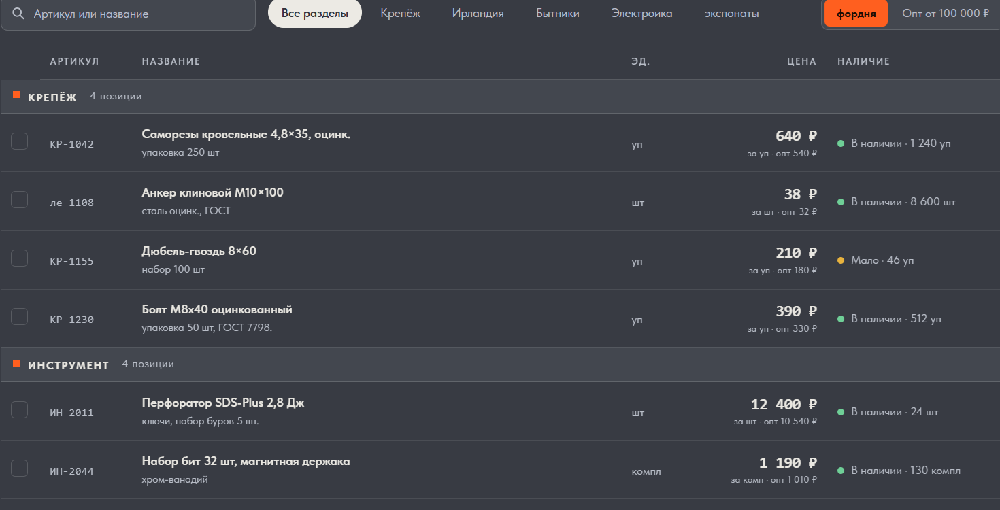

# Tilda: прайс-лист оптового склада

Одностраничный сайт с каталогом товаров, фильтрами и переключателем цен.

**Демо:** [enjoy-systematic-sequoia.tilda.ws](https://enjoy-systematic-sequoia.tilda.ws/)

## Что на странице

- Главный экран с описанием компании и кнопками «Скачать прайс» / «Оптовые цены».
- Каталог товаров с поиском по названию и артикулу.
- Фильтры по категориям: Крепёж, Инструмент, Расходники, Электрика, Стройматериал.
- Переключатель «Розница / Опт».
- Цены (розничная + оптовая).
- Индикаторы наличия (в наличии / мало / под заказ).
- Адаптивная вёрстка (проверено на Android и iPhone).

## Скриншоты

## Стек

- Tilda (Zero Block + стандартные блоки)
- Адаптивная вёрстка

## Особенности

- Поиск и фильтры работают без перезагрузки страницы.
- Переключатель цен меняет цену и цену за опт.
- Индикаторы наличия подсвечиваются цветом.
